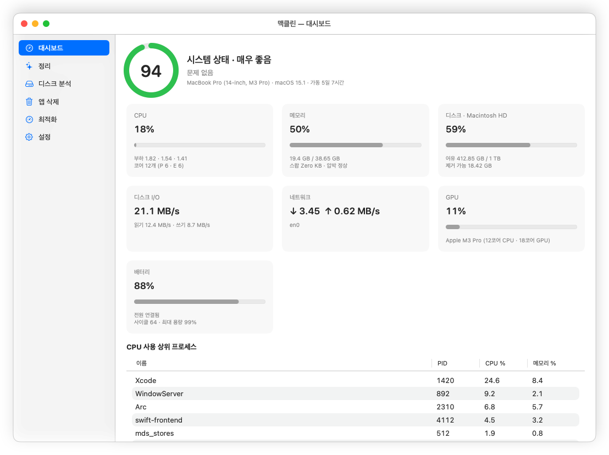
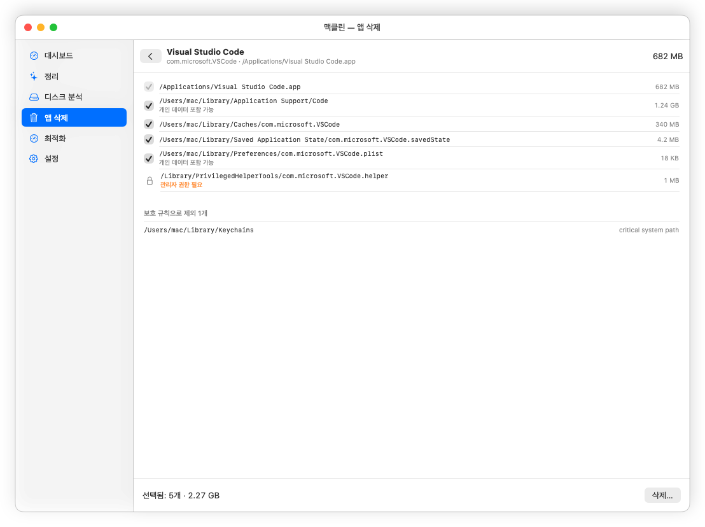

<p align="center">
  
</p>

<h1 align="center">맥클린 (MacClean)</h1>

<p align="center">
  <strong>macOS용 네이티브 디스크 정리 · 앱 언인스톨러 · 시스템 모니터 앱</strong><br/>
  Swift &amp; SwiftUI로 구현한 빠르고 안전한 맥 관리 도구
</p>

<p align="center">
  
  
  <a href="LICENSE"></a>
  <a href="https://github.com/kwakchangkyoung/mc/releases"></a>
</p>

---

**맥클린(MacClean)**은 [Mole](https://github.com/tw93/Mole) CLI(GPL-3.0)의 정리 규칙과 다중 안전 장치를 macOS 네이티브 **Swift / SwiftUI** 애플리케이션으로 새롭게 구현한 프로젝트입니다. 외부 런타임 의존성 없이 Apple 시스템 API(`IOKit`, `getattrlistbulk`, `proc_pidinfo`, `removefile` 등)를 직접 활용하여 빠르고 가볍게 동작합니다.

> **참고**: 본 프로젝트는 독립적인 오픈소스 구현체이며, 원작자인 Mole 프로젝트 팀과는 직접적인 관련이 없습니다.

---

## 목차

- [주요 기능 및 스크린샷](#주요-기능-및-스크린샷)
  - [1. 실시간 시스템 대시보드](#1-실시간-시스템-대시보드)
  - [2. 사용자 영역 캐시 및 로그 정리](#2-사용자-영역-캐시-및-로그-정리)
  - [3. 고속 디스크 공간 분석](#3-고속-디스크-공간-분석)
  - [4. 앱 삭제 및 잔여물 정리](#4-앱-삭제-및-잔여물-정리)
  - [5. 시스템 진단 및 최적화](#5-시스템-진단-및-최적화)
  - [6. 다중 안전 장치 아키텍처](#6-다중-안전-장치-아키텍처)
- [설치 및 실행 방법](#설치-및-실행-방법)
  - [방법 1: GitHub Releases에서 다운로드 (권장)](#방법-1-github-releases에서-다운로드-권장)
  - [방법 2: 소스 코드에서 직접 빌드](#방법-2-소스-코드에서-직접-빌드)
  - [권한 설정 (전체 디스크 접근 권한)](#권한-설정-전체-디스크-접근-권한)
  - [헤드리스(CLI) 실행 모드](#헤드리스cli-실행-모드)
- [GitHub 릴리즈 배포 가이드](#github-릴리즈-배포-가이드)
- [프로젝트 구조](#프로젝트-구조)
- [라이선스](#라이선스)

---

## 주요 기능 및 스크린샷

### 1. 실시간 시스템 대시보드



시스템 전반의 자원 사용량과 상태를 1초 주기로 수집하여 한눈에 보여줍니다.

- **시스템 건강 점수 (0~100점)**: CPU 부하, 메모리 사용률 및 압박 수준, 스왑 사용량, 디스크 여유 공간, 디스크 I/O, 배터리 수명, 가동 시간(Uptime)을 종합 평가하여 상태(`매우 좋음` / `좋음` / `보통` / `점검 필요`)와 주의 항목을 표시합니다.
- **CPU & GPU 모니터**: 전체 CPU 사용률, 1·5·15분 평균 부하(Load Average), 물리/논리 코어 및 P-코어·E-코어 구성을 표시하며, Apple Silicon / Intel GPU 사용률과 칩셋 정보를 함께 제공합니다.
- **메모리 & 스왑**: 활성·압축 메모리를 반영한 실사용량, 스왑 사용량, 커널 메모리 압박 상태(`정상` / `주의` / `위험`)를 실시간으로 표시합니다.
- **디스크 용량 & 실시간 I/O**: 마운트된 볼륨별 여유 공간과 macOS 제거 가능(Purgeable) 용량을 구분하여 보여주고, 실시간 읽기/쓰기 속도(MB/s)를 측정합니다.
- **네트워크 & 배터리**: 활성 네트워크 인터페이스별 수신/송신 속도(`↓`/`↑` MB/s)와 배터리의 충전 상태, 남은 시간, 충방전 사이클 수, 설계 용량 대비 최대 용량(%)을 표시합니다.
- **상위 프로세스 목록**: 현재 CPU 사용량이 가장 높은 상위 프로세스의 이름, PID, CPU %, 메모리 %를 실시간 테이블로 제공합니다.

---

### 2. 사용자 영역 캐시 및 로그 정리


미리보기 스캔(Dry-run)으로 정리 대상을 먼저 확인한 뒤, 원하는 그룹만 골라 안전하게 삭제할 수 있습니다.

- **스캔 후 선택 실행**: `스캔` 버튼은 아무 파일도 삭제하지 않으며, 실제 삭제와 동일한 안전 검증을 통과한 항목과 예상 확보 용량만 집계합니다.
- **5대 정리 카테고리 (`CleanCatalog` 32개 규칙)**:
  - **사용자 기본**: 사용자 앱 캐시(`~/Library/Caches/*`), 앱 로그(`~/Library/Logs/*`), 휴지통(`~/.Trash/*`), 최근 사용 항목 목록(`.sfl*`)
  - **앱 캐시**: 저장된 앱 상태(`Saved Application State`), Apple 시스템/컨테이너 캐시(`WebKit`, `QuickLook`, `GeoServices` 등), 진단 리포트, 미완료 다운로드(`.download`, `.crdownload`, `.part`), 30일 경과 크래시 리포트, 샌드박스 컨테이너 캐시 및 그룹 컨테이너 로그, Handoff 공유 클립보드
  - **브라우저**: Safari, Google Chrome, Microsoft Edge, Brave, Arc, Firefox의 웹 캐시·GPU/Shader/Code 캐시
  - **개발 도구**: Xcode(`DerivedData`, `Products`, `IB Support`, 캐시), iOS Simulator 캐시·로그, Clang 모듈 캐시, Swift Package Manager, Android 빌드 캐시, `npm`, Python(`pyenv`, `poetry`, `ruff`, `mypy`, `pytest`), Rust(`cargo`, `rustup`), Ruby(`rbenv`, `gem`, `bundle`), 컨테이너·클라우드 CLI(`Docker Buildx`, `kubectl`, `AWS`, `gcloud`, `Azure`), 프론트엔드 도구(`Vite`, `Webpack`, `Turbo`, `Parcel`, `ESLint`, `Prettier`, `TypeScript`, `Electron`, `node-gyp`), 기타 툴체인(`Bazel`, `Zig`, `Terraform`, `Prisma`, `Composer` 등)
  - **앱과 유틸리티**: VS Code 캐시·로그·확장 VSIX 캐시, Discord·Slack 캐시, 셸 임시 파일(`.zcompdump*`, `.lesshst` 등)
- **실행 중 앱 자동 보류**: 브라우저나 Xcode, Simulator, VS Code, Discord, Slack 등이 실행 중이면 해당 규칙을 자동으로 건너뛰어(`앱 실행 중이라 건너뜀`) 작업 중 데이터 손상을 방지합니다.

---

### 3. 고속 디스크 공간 분석


홈 폴더 및 하위 디렉터리의 공간 점유 현황을 빠르게 분석하고 탐색합니다.

- **고성능 병렬 스캐너 (`DiskScanner`)**: 저수준 `getattrlistbulk(2)` 시스템 콜과 멀티코어 워커 풀을 결합해 수십만 개의 파일이 있는 디렉터리도 빠르게 스캔합니다.
- **정확한 할당 크기 계산**: 논리적 파일 크기와 디스크 블록 할당 크기(`st_blocks * 512`) 중 실제 점유 크기를 계산하며, 하드링크는 `dev:inode` 기준으로 한 번만 합산하고 심볼릭 링크나 다른 볼륨/마운트 포인트는 중복 추적하지 않습니다.
- **즉시 드릴다운 & 브레드크럼 내비게이션**: 스캔 트리를 메모리에 유지하여 하위 폴더를 더블클릭(또는 `Return` 키)할 때 재스캔 없이 즉시 이동하며, 상단 경로 막대(Breadcrumb)와 뒤로 가기 버튼으로 자유롭게 탐색할 수 있습니다.
- **항목 보기 & 큰 파일 탭**:
  - **항목 탭**: 현재 폴더의 하위 폴더·파일을 크기순으로 정렬하고 비중 바(%), 용량, 내부 파일 개수를 표시합니다.
  - **큰 파일 탭**: 전체 하위 트리에서 가장 큰 상위 20개 대용량 파일(1MB 이상)을 별도로 추출해 보여줍니다(`node_modules`, `.git`, `DerivedData` 등 폴딩 디렉터리와 소스 코드 파일은 제외).
- **Finder 연동 및 휴지통 이동**: 우클릭 컨텍스트 메뉴나 하단 버튼으로 선택한 항목을 Finder에서 바로 열거나, 안전 검증을 거쳐 휴지통으로 이동할 수 있습니다.

---

### 4. 앱 삭제 및 잔여물 정리



앱 번들만 지웠을 때 `~/Library` 곳곳에 남는 설정·캐시·컨테이너 잔여물까지 찾아내어 한 번에 정리합니다.

- **설치된 앱 자동 인벤토리**: `/Applications`, `~/Applications`, 입력기(`Input Methods`) 폴더를 스캔하여 앱 이름, 번들 ID, 마지막 사용일(`오늘 사용`, `5일 전` 등), 앱 크기를 실시간으로 표시하며 검색 필터를 지원합니다.
- **정밀 잔여물 탐색 (`LeftoverFinder`)**: 앱 선택 시 번들 ID, 정규화된 앱 이름, 실행 파일명을 기반으로 `Application Support`, `Caches`, `Logs`, `Preferences`, `Containers`, `Group Containers`, `Saved Application State`, `WebKit`, `HTTPStorages`, `LaunchAgents` 및 사용자 캐시/임시 디렉터리(`/var/folders/...`)에서 관련 파일을 모두 찾아냅니다.
- **공유 데이터 및 민감 정보 보호**:
  - 같은 벤더/계열의 형제 앱(Sibling App)이 함께 설치되어 있으면 이름 기반 매칭을 제한하여 공유 폴더 오삭제를 방지합니다.
  - 계정·인증 정보 등이 포함될 수 있는 경로에는 `개인 데이터 포함 가능` 안내를 표시합니다.
  - `/Library` 등 관리자 권한이 필요한 시스템 영역 잔여물은 자물쇠 아이콘(`관리자 권한 필요`)과 함께 목록에 참고용으로 표시합니다.
- **안전한 휴지통 이동**: 실행 중인 앱(번들 내부 헬퍼 프로세스 포함)이나 전용 언인스톨러가 필요한 앱은 삭제를 차단하며, 삭제 시 영구 삭제가 아닌 **macOS 휴지통 이동**만 수행합니다.

---

### 5. 시스템 진단 및 최적화


시스템 상태를 읽기 전용으로 먼저 진단하고, 사용자 영역에서 안전하게 수행할 수 있는 유지보수 작업을 실행합니다.

- **읽기 전용 사전 진단 (`OptimizeDiagnostics`)**: 메모리 압박, 스왑 사용량, 디스크 여유 공간, Spotlight 인덱싱 상태 등을 점검하여 상단에 요약합니다.
- **최적화 작업 카탈로그 (총 19종 중 사용자 권한 14종 실행 가능)**:
  - **Finder 캐시 새로고침**: QuickLook 썸네일 및 아이콘 캐시 초기화
  - **앱 상태 정리**: 30일 이상 지난 오래된 앱 저장 상태(`*.savedState`) 정리
  - **손상된 설정 복구**: 문법 오류가 있는 서드파티 환경설정(`.plist`) 파일 감지 및 정리
  - **데이터베이스 최적화**: Mail, 메시지, Safari 등의 SQLite 데이터베이스 `VACUUM` 수행(사용 중인 DB는 자동 제외)
  - **네트워크 `.DS_Store` 방지**: 네트워크 및 외장 볼륨에 `.DS_Store` 파일이 생성되지 않도록 설정
  - **레거시 오버라이드 정리 / Spotlight 고아 규칙 정리 / 공유 파일 목록(`.sfl*`) 복구**
  - **로그인 항목 점검 & LaunchAgent 점검**: 대상 실행 파일이 사라진 깨진 항목을 찾아 보고(자동 삭제하지 않음)
  - **격리 기록 / 알림 기록(30일 경과) / 사용 기록(CoreDuet, 90일 경과) 정리**
- **6종 실행 결과 피드백**: 각 작업 실행 후 `적용됨`, `변경 없음`, `건너뜀`, `실행 불가`, `확인 필요`, `실패` 상태를 아이콘과 메시지로 명확히 표시합니다.

---

### 6. 다중 안전 장치 아키텍처

맥클린의 모든 삭제 및 휴지통 이동 작업은 단 하나의 관문인 **`SafeDeleter`**를 거치도록 설계되어 있습니다.

1. **시스템 핵심 경로 차단 (`PathPolicy`)**: `/System`, `/Library`, `/Applications`, `/Users`, `/bin`, `/usr`, `/etc`, `/var` 등 핵심 루트와 필수 앱(`Finder.app`, `Safari.app`, `Keychains` 등)을 차단합니다. 심볼릭 링크를 통한 우회 경로와 APFS 대소문자 별칭(`stat` 파일 ID 대조)까지 모두 검증합니다.
2. **보호 앱 데이터 (`ProtectionPolicy`)**: 비밀번호 관리자(1Password, Bitwarden 등), VPN, 클라우드 스토리지, 주요 개발 도구 및 시스템 설정과 관련된 보호 대상 번들 ID/경로를 자동으로 제외합니다.
3. **실시간 프로세스 및 열린 파일 검사 (`ProbeContext`)**:
   - 실행 중인 앱의 캐시(`~/Library/Caches/<bundle-id>` 등)는 삭제하지 않습니다.
   - `.db`, `.sqlite`, `.sqlite3` 파일(및 `-wal`, `-shm`, `-journal`)이 현재 프로세스에 의해 열려 있으면 삭제를 거부(`sqlite in use`)합니다.
   - 진행 중인 다운로드 파일(`.download`, `.crdownload`, `.part`, `.incomplete`)이 열려 있으면 보호합니다.
   - 컴파일된 CoreML 모델 캐시(`.mlmodelc`)를 포함한 디렉터리는 재빌드 비용 방지를 위해 보호합니다.
4. **TOCTOU 방지 (`PathIdentity`)**: 스캔 시점에 기록한 부모 및 대상의 `dev:inode` 식별자를 삭제 직전에 다시 대조하여, 스캔과 실행 사이에 파일이 바뀌었거나 심볼릭 링크로 교체된 경우 즉시 건너뜁니다.
5. **화이트리스트 및 감사 로그**:
   - 화이트리스트 파일(`~/Library/Application Support/MacClean/whitelist`)에 등록된 경로(한 줄에 하나, `~` 및 `*` 와일드카드 지원)는 항상 제외됩니다. 화이트리스트 파일이 존재하지만 읽기에 실패한 경우 **Fail-Closed** 원칙에 따라 작업을 즉시 중단합니다.
   - 모든 삭제·휴지통 이동·건너뜀·실패 내역은 `~/Library/Logs/MacClean/operations.log`에 기록됩니다.

---

## 설치 및 실행 방법

### 시스템 요구 사항

- **운영체제**: macOS 14.0 (Sonoma) 이상
- **아키텍처**: Apple Silicon (`arm64`) 및 Intel (`x86_64`) 지원
- **개발 환경 (소스 빌드 시)**: Xcode 16+ 또는 Swift 6.0+ Command Line Tools

---

### 방법 1: GitHub Releases에서 다운로드 (권장)

1. [**GitHub Releases 페이지**](https://github.com/kwakchangkyoung/mc/releases)에서 최신 버전의 `MacClean-v0.1.0-macos.dmg` 또는 `MacClean-v0.1.0-macos.zip` 파일을 다운로드합니다.
2. **DMG 다운로드 시**: 디스크 이미지를 열고 `MacClean.app`을 `Applications`(`응용 프로그램`) 폴더로 드래그합니다.
3. **ZIP 다운로드 시**: 압축을 풀고 생성된 `MacClean.app`을 `/Applications` 폴더로 이동합니다.

> **최초 실행 시 보안 안내 (Gatekeeper)**:
> 오픈소스 빌드 파일은 로컬 Ad-hoc 서명으로 패키징되어 있어, 최초 실행 시 *"개발자를 확인할 수 없기 때문에 열 수 없습니다"* 또는 *"손상되었기 때문에 열 수 없습니다"* 경고가 나타날 수 있습니다.
> 아래 터미널 명령어로 격리 속성(Quarantine)을 제거한 뒤 실행하거나, Finder에서 앱 아이콘을 **Control-클릭(우클릭) → 열기**를 선택해 주세요.
> ```bash
> xattr -dr com.apple.quarantine /Applications/MacClean.app
> open /Applications/MacClean.app
> ```

---

### 방법 2: 소스 코드에서 직접 빌드

저장소를 클론한 뒤 포함된 빌드 스크립트로 `MacClean.app` 번들을 생성하고 바로 실행할 수 있습니다.

```bash
# 1. 저장소 클론
git clone https://github.com/kwakchangkyoung/mc.git
cd mc

# 2. 단위 테스트 실행 (선택 사항)
swift test

# 3. Release 모드로 MacClean.app 번들 빌드
./scripts/build-app.sh

# 4. 앱 실행
open build/MacClean.app
```

응용 프로그램 폴더에 설치하려면 다음 명령을 실행하세요:

```bash
cp -R build/MacClean.app /Applications/
```

---

### 권한 설정 (전체 디스크 접근 권한)

Safari 캐시, Mail 데이터베이스, 휴지통(`~/.Trash`), 일부 샌드박스 컨테이너를 빠짐없이 스캔하고 정리하려면 **전체 디스크 접근 권한(Full Disk Access)**이 필요합니다.

1. 앱 내 상단 배너의 **`설정 열기`** 버튼 또는 좌측 **`설정` 탭 → `개인정보 보호 설정 열기`**를 클릭합니다.
2. **시스템 설정 → 개인정보 보호 및 보안 → 전체 디스크 접근 권한**에서 `맥클린(MacClean)`을 추가하고 스위치를 켭니다.

---

### 헤드리스(CLI) 실행 모드

GUI를 띄우지 않고 터미널에서 스캔 결과(Dry-run)와 시스템 지표를 텍스트로 출력할 수 있습니다. 헤드리스 모드는 **어떠한 파일도 삭제하거나 변경하지 않습니다.**

```bash
# 실행 파일 경로 (빌드 후)
BIN="build/MacClean.app/Contents/MacOS/MacClean"

# 1. 시스템 상태 및 건강 점수 출력
"$BIN" --status

# 2. 정리(Clean) 스캔 시뮬레이션 (삭제 없음)
"$BIN" --clean-dry-run

# 3. 특정 경로 디스크 분석 (경로 생략 시 홈 디렉터리)
"$BIN" --analyze ~/Downloads

# 4. 특정 앱의 언인스톨 잔여물 탐색 시뮬레이션 (앱 이름 또는 번들 ID)
"$BIN" --uninstall-dry-run "Visual Studio Code"

# 5. 최적화 진단 및 작업별 시뮬레이션 (변경 없음)
"$BIN" --optimize-dry-run
```

---

## GitHub 릴리즈 배포 가이드

이 저장소에는 로컬 패키징 스크립트([`scripts/package-release.sh`](scripts/package-release.sh))와 GitHub Actions 자동 배포 워크플로([`.github/workflows/release.yml`](.github/workflows/release.yml))가 구성되어 있습니다.

### 1. Git 태그 푸시로 자동 릴리즈 (GitHub Actions)

`v*` 형식의 버전 태그를 생성하여 GitHub에 푸시하면, GitHub Actions가 자동으로 테스트(`swift test`)를 수행한 뒤 Universal `.app` 번들을 빌드하고 `.dmg`, `.zip`, `SHA256SUMS.txt` 파일을 첨부하여 **GitHub Release**를 생성합니다.

```bash
# 버전 태그 생성 및 원격 저장소 푸시
git tag v0.1.0
git push origin v0.1.0
```

또한 GitHub 저장소의 **Actions → Release → Run workflow** 버튼을 통해 원하는 버전 번호를 입력하여 수동으로 패키징 아티팩트를 빌드할 수도 있습니다.

### 2. 로컬에서 릴리즈 패키지 생성 및 `gh` CLI로 배포

로컬 Mac에서 직접 배포용 `.dmg`, `.zip`, `SHA256SUMS.txt`를 생성하고 GitHub CLI(`gh`)로 릴리즈를 등록할 수 있습니다.

```bash
# 1. build/release/ 하위에 .dmg, .zip, SHA256SUMS.txt 생성
./scripts/package-release.sh 0.1.0

# 2. GitHub CLI로 릴리즈 생성 및 파일 업로드
gh release create v0.1.0 \
  build/release/MacClean-v0.1.0-macos.dmg \
  build/release/MacClean-v0.1.0-macos.zip \
  build/release/SHA256SUMS.txt \
  --title "MacClean v0.1.0" \
  --generate-notes
```

---

## 프로젝트 구조

```text
mc/
├── Package.swift                  # Swift Package Manager 매니페스트 (macOS 14+)
├── Resources/
│   ├── AppIcon.icns               # 앱 아이콘 번들 리소스
│   └── AppIcon-preview.png        # 아이콘 미리보기 이미지
├── Sources/
│   ├── MacClean/                  # SwiftUI 앱 타깃 (뷰, 뷰모델, CLI 진입점)
│   │   ├── MacCleanApp.swift      # 메인 윈도우 및 사이드바 내비게이션
│   │   ├── DashboardView.swift    # 실시간 시스템 상태 대시보드 화면
│   │   ├── CleanView.swift        # 캐시·로그 스캔 및 선택 정리 화면
│   │   ├── AnalyzeView.swift      # 디스크 공간 분석 및 큰 파일 탐색 화면
│   │   ├── UninstallView.swift    # 앱 목록 및 잔여물 휴지통 이동 화면
│   │   ├── OptimizeView.swift     # 시스템 진단 및 최적화 실행 화면
│   │   ├── SettingsView.swift     # 권한·화이트리스트·로그 경로 설정 화면
│   │   └── HeadlessReport.swift   # CLI 헤드리스(Dry-run) 리포트 출력기
│   └── MacCleanCore/              # 핵심 도메인 로직 라이브러리 (단위 테스트 대상)
│       ├── Safety/                # SafeDeleter, PathPolicy, ProtectionPolicy, Whitelist
│       ├── Status/                # CPU, Memory, Disk, Network, Battery, GPU, HealthScore
│       ├── Clean/                 # CleanCatalog(32개 규칙), CleanEngine
│       ├── Analyze/               # DiskScanner(getattrlistbulk 병렬 스캐너)
│       ├── Uninstall/             # AppInventory, LeftoverFinder, UninstallEngine
│       ├── Optimize/              # OptimizeTask(19개 작업), OptimizeDiagnostics, OptimizeEngine
│       ├── System/                # FileStat, ProcessProbe, OpenFiles, SizeCalculator, Shell
│       └── Log/                   # OperationLog
├── Tests/
│   └── MacCleanCoreTests/         # 안전 정책, 스캐너, 엔진 단위 테스트
├── scripts/
│   ├── build-app.sh               # Release 빌드 및 MacClean.app 번들 생성 스크립트
│   ├── package-release.sh         # 배포용 .dmg, .zip, SHA256SUMS.txt 패키징 스크립트
│   ├── make-icon.swift            # AppIcon.icns 생성 스크립트
│   └── extract_protection.py      # 보호 데이터 추출 스크립트
└── docs/
    ├── DESIGN.md                  # 전체 아키텍처 및 설계 원칙 문서
    ├── analysis/                  # 기능별 상세 분석 및 스펙 문서 (01~05)
    └── screenshots/               # README용 기능별 화면 스크린샷
```

상세한 설계 원칙과 기능별 분석 문서는 [`docs/DESIGN.md`](docs/DESIGN.md) 및 [`docs/analysis/`](docs/analysis/) 디렉터리에서 확인할 수 있습니다.

---

## 라이선스

이 프로젝트는 **[GNU General Public License v3.0 (GPL-3.0)](LICENSE)** 라이선스 하에 배포됩니다.

- 정리 규칙 및 안전 정책 설계는 [tw93/Mole](https://github.com/tw93/Mole) (GPL-3.0)을 분석하여 Swift로 재구현했습니다.
- 보호 목록 데이터(`Sources/MacCleanCore/Safety/ProtectionData.swift`)는 Mole의 `lib/core/app_protection_data.sh`로부터 `scripts/extract_protection.py`를 통해 생성되었습니다.
