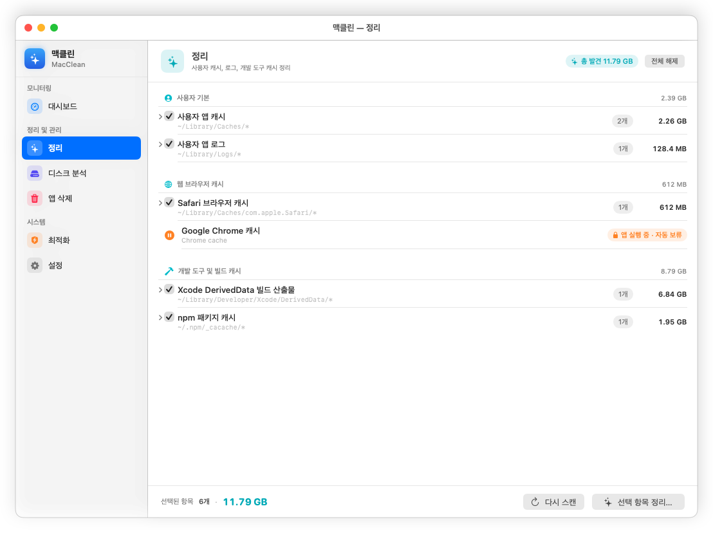
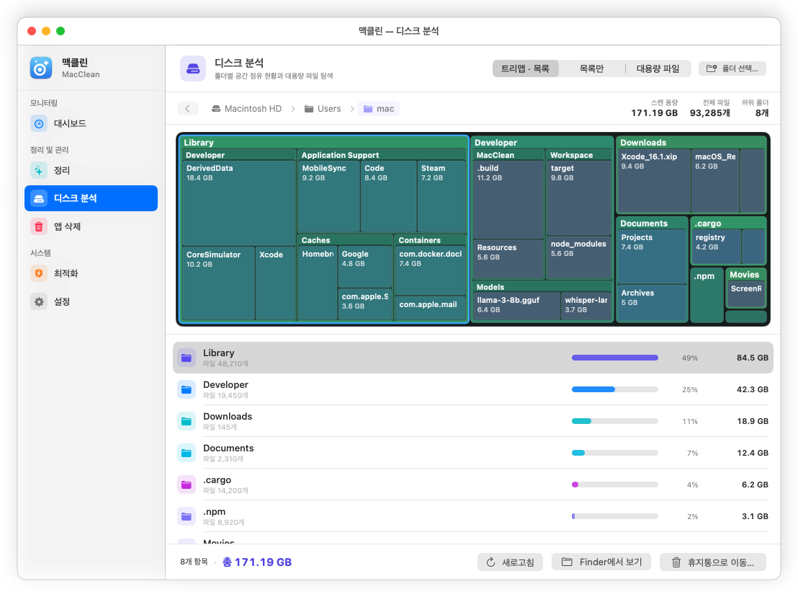
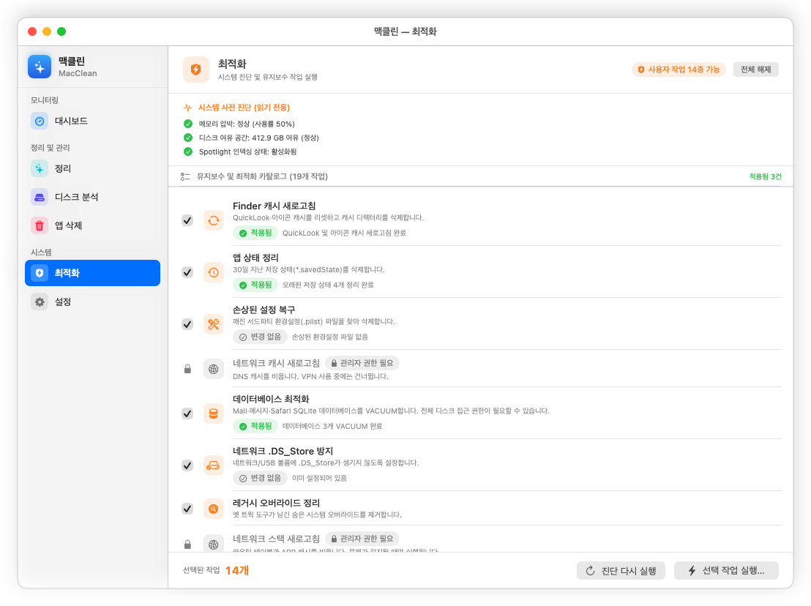

<p align="center">
  
</p>

<h1 align="center">맥클린 (MacClean)</h1>

<p align="center">
  <strong>macOS용 네이티브 디스크 정리 · 앱 언인스톨러 · 시스템 모니터 앱</strong><br/>
  Swift &amp; SwiftUI로 구현한 빠르고 안전하며 투명한 오픈소스 맥 관리 도구
</p>

<p align="center">
  
  
  
  
  <a href="LICENSE"></a>
  <a href="https://github.com/kwakchangkyoung/mc/releases"></a>
</p>

---

## 💡 맥클린의 핵심 약속

> ### 🎁 1. 완전 무료 (100% Free & Open Source)
> 맥클린은 **구독료, 인앱 결제, 유료 기능 제한, 광고**가 전혀 없습니다. 누구나 자유롭게 다운로드하고 모든 기능을 무료로 이용할 수 있습니다.

> ### 🔒 2. 개인정보 수집 없음 (Zero Telemetry & Tracking)
> 맥클린은 인터넷을 통해 사용자의 활동, 기기 정보, 로그 또는 파일 데이터를 **외부 서버로 일절 전송하지 않습니다**. 모든 시스템 상태 수집과 파일 분석·정리는 **100% 사용자의 로컬 Mac 내부에서만** 독립적으로 안전하게 수행됩니다.

> ### 🛡️ 3. 타협 없는 안전성 (Safe by Design)
> 상용 클리너 앱들의 무분별한 파일 삭제로 인한 시스템 손상 문제를 방지하기 위해, [Mole](https://github.com/tw93/Mole) CLI(GPL-3.0)의 검증된 안전 규칙과 `SafeDeleter` 단일 삭제 깔때기를 적용했습니다. 판단할 수 없는 항목은 거부하고, 실행 중인 앱의 캐시는 건너뛰며, 앱 삭제 및 디스크 분석 삭제 시에는 영구 삭제가 아닌 **macOS 휴지통으로 안전하게 이동**합니다.

---

## 목차

- [주요 기능 및 스크린샷](#주요-기능-및-스크린샷)
  - [1. 실시간 시스템 대시보드](#1-실시간-시스템-대시보드)
  - [2. 사용자 영역 캐시 및 로그 정리](#2-사용자-영역-캐시-및-로그-정리)
  - [3. 고속 디스크 공간 분석](#3-고속-디스크-공간-분석)
  - [4. 앱 삭제 및 잔여물 정리](#4-앱-삭제-및-잔여물-정리)
  - [5. 시스템 진단 및 최적화](#5-시스템-진단-및-최적화)
  - [6. 다중 안전 장치 아키텍처](#6-다중-안전-장치-아키텍처)
- [설치 및 실행 방법](#설치-및-실행-방법)
  - [방법 1: GitHub Releases에서 다운로드 (권장)](#방법-1-github-releases에서-다운로드-권장)
  - [방법 2: 소스 코드에서 직접 빌드](#방법-2-소스-코드에서-직접-빌드)
  - [권한 설정 (전체 디스크 접근 권한)](#권한-설정-전체-디스크-접근-권한)
  - [헤드리스(CLI) 실행 모드](#헤드리스cli-실행-모드)
- [GitHub 릴리즈 배포 가이드](#github-릴리즈-배포-가이드)
- [프로젝트 구조](#프로젝트-구조)
- [라이선스](#라이선스)

---

## 주요 기능 및 스크린샷

### 1. 실시간 시스템 대시보드


시스템 전반의 자원 사용량과 건강 상태를 1초 주기로 실시간 모니터링합니다.

- **시스템 건강 점수 (0~100점)**: CPU 부하, 메모리 사용률 및 압박 수준, 스왑 사용량, 디스크 여유 공간, 디스크 I/O, 배터리 수명, 가동 시간(Uptime)을 종합 평가하여 점수 게이지와 상태 캡슐 배지(`매우 좋음` / `좋음` / `보통` / `점검 필요`)를 표시합니다.
- **기기 메타데이터 칩**: 현재 Mac 모델명, macOS 버전, 시스템 가동 시간을 깔끔한 칩 형태로 제공합니다.
- **모던 지표 카드**:
  - **CPU & GPU**: 전체 CPU 사용률, 부하 평균(Load Average), P-코어·E-코어 구성, Apple Silicon / Intel GPU 엔진 가동률 및 칩셋 사양
  - **메모리 & 스왑**: 실사용 메모리, 스왑 사용량, 커널 메모리 압박 단계(`정상` / `주의` / `위험`)
  - **디스크 용량 & I/O**: 볼륨별 사용률, 여유 공간 및 macOS 제거 가능(Purgeable) 공간 구분, 실시간 초당 읽기/쓰기 속도
  - **네트워크 & 배터리**: 실시간 수신/송신 처리량(`↓`/`↑` MB/s), 전원 연결 여부, 배터리 충전 잔여 시간, 사이클 수 및 배터리 수명(%)
- **상위 프로세스 실시간 테이블**: CPU 점유율이 높은 상위 프로세스의 이름, PID, CPU 점유율, 메모리 점유율을 실시간 미니 바 그래프와 함께 확인 가능합니다.

---

### 2. 사용자 영역 캐시 및 로그 정리



미리보기 스캔(Dry-run)으로 정리 대상을 먼저 확인한 뒤, 원하는 항목만 선택하여 안전하게 삭제할 수 있습니다.

- **스캔 후 선택 실행**: `스캔` 버튼은 파일을 일절 건드리지 않으며, 삭제 시와 동일한 안전 검증을 거친 항목과 용량만을 계산합니다.
- **편리한 전체 선택/해제**: 상단 바에 감지된 총 용량 배지와 함께 **`전체 선택` / `전체 해제`** 버튼을 제공합니다.
- **직관적인 한국어 카탈로그 (5대 카테고리 · 32개 규칙)**:
  - **사용자 기본**: 사용자 앱 캐시, 사용자 앱 로그, 휴지통, 최근 사용 항목 기록
  - **앱 캐시 및 컨테이너**: 앱 저장 상태(Saved Application State), Apple 시스템 서비스 캐시, 진단 리포트, 미완료 다운로드 임시 파일(`.download` 등), 30일 경과 크래시 리포트, 샌드박스 앱 컨테이너 캐시, 그룹 컨테이너 로그, Handoff 공유 클립보드
  - **웹 브라우저 캐시**: Safari, Chrome, Edge, Brave, Arc, Firefox의 웹·GPU·Code 캐시
  - **개발 도구 및 빌드 캐시**: Xcode DerivedData, Xcode 캐시·아카이브 산출물, iOS 시뮬레이터 캐시·로그, Clang 모듈 캐시, SwiftPM 및 Android 빌드 캐시, npm 패키지 캐시, Python 도구 캐시(`pyenv` · `poetry` · `ruff` · `pytest`), Rust Cargo · Rustup, Ruby Gem · Bundler, Docker · Kubernetes · 클라우드 CLI 로그, 프론트엔드 도구(`Vite` · `Webpack` · `Turbo`), 셸 캐시, 기타 개발 툴체인(`Bazel` · `Zig` · `Terraform` 등)
  - **앱과 유틸리티**: Visual Studio Code 캐시·로그·확장 VSIX, 메신저 앱 캐시(Discord, Slack), 셸 임시 파일
- **실행 중인 앱 자동 감지 및 보호**: 브라우저나 개발 도구 등이 실행 중인 경우 자동으로 감지하여 주황색 상태 배지(`앱 실행 중 · 자동 보류`)와 함께 삭제를 안전하게 건너뜁니다.

---

### 3. 고속 디스크 공간 분석



홈 폴더 및 원하는 디렉터리의 공간 점유 현황을 고속으로 분석하고 편리하게 탐색합니다.

- **초고속 병렬 스캐너 (`DiskScanner`)**: macOS 저수준 `getattrlistbulk(2)` 시스템 콜과 멀티코어 워커 풀을 적용해 수십만 개의 파일이 있는 폴더도 수초 내에 분석합니다.
- **스토리지 분포 바 (`StorageBreakdownBar`)**: 현재 폴더 내 상위 5개 항목이 차지하는 크기 비중을 시각적인 컬러 바로 한눈에 보여줍니다.
- **자유로운 폴더 선택**: 기본 홈 폴더 외에도 상단 **`폴더 선택…`** 버튼을 통해 외장 드라이브나 특정 디렉터리를 바로 지정하여 분석할 수 있습니다.
- **즉각적인 드릴다운 및 브레드크럼**: 스캔 트리를 메모리에 보관하여 하위 폴더를 더블클릭(또는 `Return` 키)할 때 재스캔 없이 즉시 하위 폴더로 이동하며, 상단 경로 막대를 통해 원하는 상위 경로로 자유롭게 이동합니다.
- **항목별 보기 & 대용량 파일 탭**:
  - **폴더 · 항목 탭**: 크기순 정렬, 점유율 게이지 바, 항목별 실제 디스크 점유 용량 및 내부 파일 수 표시
  - **대용량 파일 탭**: 하위 경로 전체에서 1MB 이상의 대형 단일 파일 상위 20개를 추출하여 표시
- **안전한 휴지통 이동**: 우클릭 메뉴 또는 하단 버튼을 통해 항목을 Finder에서 확인하거나 안전하게 휴지통으로 이동합니다.

---

### 4. 앱 삭제 및 잔여물 정리


앱 번들뿐만 아니라 `~/Library` 곳곳에 남겨진 설정, 캐시, 컨테이너 등의 잔여물까지 추적하여 완전하게 제거합니다.

- **실제 앱 아이콘 및 버전 표시**: 설치된 앱 목록에서 실제 macOS 앱 아이콘(`AppBundleIcon`)과 버전 배지를 선명하게 보여줍니다.
- **다양한 정렬 및 실시간 검색**: `크기순`, `이름순`, `최근 사용순` 정렬 옵션과 이름/번들 ID 검색 필터를 지원합니다.
- **정밀 잔여물 탐색기 (`LeftoverFinder`)**: `Application Support`, `Caches`, `Preferences`, `Saved Application State`, `Containers`, `Group Containers`, `LaunchAgents`, `/var/folders` 임시 디렉터리 등을 정밀 탐색합니다.
- **카테고리 뱃지 및 민감 데이터 안내**: 각 잔여물 경로에 유형 뱃지를 표시하며, 계정 정보가 포함될 수 있는 경로에는 `개인 데이터 포함 가능` 배지를, 관리자 권한이 필요한 경로는 `관리자 권한 필요 (표시 전용)`으로 안내합니다.
- **안전한 휴지통 이동**: 실행 중인 프로세스가 감지되면 삭제를 차단하며, 영구 삭제가 아닌 **휴지통 이동**만 수행합니다. 잔여물 선택 체크박스와 **`잔여물 전체 선택/해제`** 토글을 지원합니다.

---

### 5. 시스템 진단 및 최적화



시스템의 이상 유무를 사전 진단하고, 안전한 14종의 사용자 영역 유지보수 작업을 원클릭으로 실행합니다.

- **읽기 전용 사전 진단 (`OptimizeDiagnostics`)**: 메모리 압박, 스왑 상태, 디스크 여유 공간, Spotlight 인덱싱 상태를 읽기 전용으로 사전 점검하여 상단 카드에 요약합니다.
- **최적화 작업 카탈로그 (총 19종 중 사용자 권한 14종)**:
  - **Finder 캐시 새로고침**: QuickLook 썸네일 및 아이콘 캐시 초기화
  - **앱 상태 정리**: 30일 경과 오래된 앱 저장 상태(`*.savedState`) 정리
  - **손상된 설정 복구**: 문법 오류가 있는 깨진 서드파티 `.plist` 파일 감지 및 정리
  - **데이터베이스 최적화**: Mail, 메시지, Safari 등의 SQLite DB `VACUUM` (사용 중인 DB는 안전하게 제외)
  - **네트워크 `.DS_Store` 방지**: 외장 및 네트워크 드라이브의 `.DS_Store` 자동 생성 차단
  - **기록 정리**: Gatekeeper 격리 다운로드 이력, 30일 경과 알림 기록, 90일 경과 CoreDuet 사용 추적 기록 정리
  - **무결성 점검**: 깨진 로그인 항목 및 유실된 LaunchAgent 점검 (임의 삭제하지 않고 결과만 보고)
- **실행 결과 피드백**: 각 작업별로 `적용됨`, `변경 없음`, `건너뜀`, `실행 불가`, `확인 필요`, `실패` 6종의 컬러 상태 뱃지로 결과를 명확하게 확인할 수 있습니다.

---

### 6. 다중 안전 장치 아키텍처

맥클린의 모든 삭제 및 휴지통 이동은 단 하나의 게이트웨이인 **`SafeDeleter`**를 통과합니다.

1. **시스템 핵심 경로 원천 차단 (`PathPolicy`)**: `/System`, `/Library`, `/Applications`, `/Users`, `/bin`, `/usr` 등 핵심 루트 및 시스템 앱(`Finder`, `Safari`, `Keychains` 등) 삭제를 원천 차단합니다. 심볼릭 링크 우회 및 APFS 대소문자 별칭까지 철저히 검증합니다.
2. **보호 앱 데이터 보호 (`ProtectionPolicy`)**: 암호 관리자(1Password, Bitwarden), VPN, 클라우드 드라이브, 키체인 데이터는 삭제 대상에서 항상 제외됩니다.
3. **실시간 프로세스 및 파일 잠금 검사 (`ProbeContext`)**: 실행 중인 프로세스의 캐시나 현재 사용 중인 SQLite 데이터베이스(`.db-wal`, `.db-shm` 등), 다운로드 진행 중인 파일은 삭제를 거부합니다.
4. **TOCTOU(Time-of-Check to Time-of-Use) 방어 (`PathIdentity`)**: 스캔 시점에 캡처한 `dev:inode` 식별자를 삭제 직전에 다시 대조하여, 그 사이에 파일이 변조되거나 링크로 바뀐 경우 즉시 건너뜁니다.
5. **사용자 화이트리스트 및 감사 로그**:
   - `~/Library/Application Support/MacClean/whitelist`에 등록된 경로는 항상 보호됩니다. 화이트리스트 파일을 읽을 수 없는 경우 **Fail-Closed(안전 우선 중단)** 정책으로 동작합니다.
   - 모든 작업 이력은 `~/Library/Logs/MacClean/operations.log`에 투명하게 기록됩니다.

---

## 설치 및 실행 방법

### 시스템 요구 사항

- **운영체제**: macOS 14.0 (Sonoma) 이상
- **아키텍처**: Apple Silicon (`arm64`) 및 Intel (`x86_64`) 유니버설 지원
- **빌드 도구 (소스 빌드 시)**: Xcode 16+ 또는 Swift 6.0+ Command Line Tools

---

### 방법 1: GitHub Releases에서 다운로드 (권장)

1. [**GitHub Releases 페이지**](https://github.com/kwakchangkyoung/mc/releases)에서 최신 버전의 `MacClean-v0.2.0-macos.dmg` 또는 `MacClean-v0.2.0-macos.zip` 파일을 다운로드합니다.
2. **DMG 다운로드 시**: 디스크 이미지를 열고 `MacClean.app`을 `Applications`(`응용 프로그램`) 폴더로 드래그합니다.
3. **ZIP 다운로드 시**: 압축을 풀고 `MacClean.app`을 `Applications` 폴더로 이동합니다.

> **최초 실행 시 보안 안내 (Gatekeeper)**:
> 오픈소스 빌드 파일은 로컬 서명으로 배포되므로 최초 실행 시 *"개발자를 확인할 수 없기 때문에 열 수 없습니다"* 안내가 나타날 수 있습니다.
> Finder에서 앱 아이콘을 **Control-클릭(우클릭) → [열기]**를 선택하거나, 터미널에서 격리 속성을 해제해 주세요:
> ```bash
> xattr -dr com.apple.quarantine /Applications/MacClean.app
> open /Applications/MacClean.app
> ```

---

### 방법 2: 소스 코드에서 직접 빌드

```bash
# 1. 저장소 클론
git clone https://github.com/kwakchangkyoung/mc.git
cd mc

# 2. 단위 테스트 실행
swift test

# 3. Release 모드로 MacClean.app 번들 빌드
./scripts/build-app.sh

# 4. 앱 실행
open build/MacClean.app
```

---

### 권한 설정 (전체 디스크 접근 권한)

Safari 캐시, Mail 데이터베이스, 휴지통(`~/.Trash`), 일부 샌드박스 컨테이너 캐시를 분석하고 정리하려면 **전체 디스크 접근 권한(Full Disk Access)**이 필요합니다.

1. 앱 내 상단 배너의 **`설정 열기`** 버튼 또는 좌측 **`설정` 탭 → `개인정보 보호 설정 열기`**를 클릭합니다.
2. **시스템 설정 → 개인정보 보호 및 보안 → 전체 디스크 접근 권한**에서 `맥클린(MacClean)`을 활성화합니다.

---

### 헤드리스(CLI) 실행 모드

GUI 없이 터미널에서 스캔 결과를 시뮬레이션(Dry-run)할 수 있습니다. 헤드리스 모드는 **어떠한 파일도 변경하거나 삭제하지 않습니다.**

```bash
BIN="build/MacClean.app/Contents/MacOS/MacClean"

# 1. 시스템 상태 및 건강 점수 출력
"$BIN" --status

# 2. 정리(Clean) 스캔 시뮬레이션
"$BIN" --clean-dry-run

# 3. 특정 경로 디스크 공간 분석
"$BIN" --analyze ~/Downloads

# 4. 특정 앱 잔여물 탐색 시뮬레이션
"$BIN" --uninstall-dry-run "Visual Studio Code"

# 5. 최적화 진단 및 작업 시뮬레이션
"$BIN" --optimize-dry-run
```

---

## GitHub 릴리즈 배포 가이드

저장소의 릴리즈 패키징 스크립트([`scripts/package-release.sh`](scripts/package-release.sh))와 GitHub Actions 워크플로([`.github/workflows/release.yml`](.github/workflows/release.yml))를 통해 손쉽게 배포할 수 있습니다.

### 1. Git 태그 푸시로 자동 배포 (GitHub Actions)

```bash
git tag v0.2.0
git push origin v0.2.0
```

GitHub Actions가 자동으로 단위 테스트를 거쳐 Universal 바이너리(`.dmg`, `.zip`, `SHA256SUMS.txt`)를 빌드하고 Release를 생성합니다.

### 2. 로컬에서 패키징 및 `gh` CLI로 배포

```bash
# 1. build/release/ 하위에 배포 파일 생성 (.dmg, .zip, SHA256SUMS.txt)
./scripts/package-release.sh 0.2.0

# 2. GitHub CLI로 릴리즈 생성 및 파일 업로드
gh release create v0.2.0 \
  build/release/MacClean-v0.2.0-macos.dmg \
  build/release/MacClean-v0.2.0-macos.zip \
  build/release/SHA256SUMS.txt \
  --title "MacClean v0.2.0" \
  --generate-notes
```

---

## 프로젝트 구조

```text
mc/
├── Package.swift                  # Swift Package Manager 매니페스트 (macOS 14+)
├── Resources/
│   ├── AppIcon.icns               # 앱 아이콘 번들 리소스
│   └── AppIcon-preview.png        # 아이콘 미리보기 이미지
├── Sources/
│   ├── MacClean/                  # SwiftUI 앱 타깃 (모던 UI & 내비게이션)
│   │   ├── MacCleanApp.swift      # 메인 윈도우, 사이드바, 공통 UI 컴포넌트(AppLogoView 등)
│   │   ├── DashboardView.swift    # 실시간 대시보드 및 시스템 건강 모니터
│   │   ├── CleanView.swift        # 32개 한국어 정리 규칙 및 선택 정리 화면
│   │   ├── AnalyzeView.swift      # 고속 디스크 분석 및 스토리지 비중 시각화 화면
│   │   ├── UninstallView.swift    # 앱 아이콘/정렬 지원 언인스톨러 화면
│   │   ├── OptimizeView.swift     # 시스템 진단 및 최적화 실행 화면
│   │   ├── SettingsView.swift     # 권한 및 화이트리스트 설정 화면
│   │   └── HeadlessReport.swift   # CLI 헤드리스 리포트 출력기
│   └── MacCleanCore/              # 핵심 안전 & 분석 라이브러리
│       ├── Safety/                # SafeDeleter, PathPolicy, ProtectionPolicy, Whitelist
│       ├── Status/                # CPU, Memory, Disk, Network, Battery, GPU, HealthScore
│       ├── Clean/                 # CleanCatalog(32개 규칙), CleanEngine
│       ├── Analyze/               # DiskScanner(getattrlistbulk 병렬 스캐너)
│       ├── Uninstall/             # AppInventory, LeftoverFinder, UninstallEngine
│       ├── Optimize/              # OptimizeTask(19개 작업), OptimizeDiagnostics, OptimizeEngine
│       ├── System/                # FileStat, ProcessProbe, OpenFiles, SizeCalculator, Shell
│       └── Log/                   # OperationLog
├── Tests/
│   └── MacCleanCoreTests/         # 86개 종합 안전 및 로직 단위 테스트
├── scripts/
│   ├── build-app.sh               # Universal MacClean.app 번들 빌드 스크립트
│   ├── package-release.sh         # .dmg, .zip, SHA256SUMS.txt 패키징 스크립트
│   ├── make-icon.swift            # AppIcon.icns 생성 스크립트
│   └── extract_protection.py      # 보호 데이터 추출 스크립트
└── docs/
    ├── DESIGN.md                  # 아키텍처 및 안전 설계 원칙
    ├── analysis/                  # 상세 분석 및 스펙 문서 (01~05)
    └── screenshots/               # 모던 UI 스크린샷 이미지
```

---

## 라이선스

이 프로젝트는 **[GNU General Public License v3.0 (GPL-3.0)](LICENSE)** 하에 공개되어 있습니다.

- 정리 규칙 및 안전 정책의 기본 설계는 [tw93/Mole](https://github.com/tw93/Mole) (GPL-3.0)을 기반으로 Swift로 완전히 새롭게 구현되었습니다.
- 보호 목록 데이터(`Sources/MacCleanCore/Safety/ProtectionData.swift`)는 Mole의 `lib/core/app_protection_data.sh`로부터 `scripts/extract_protection.py`를 통해 생성되었습니다.
